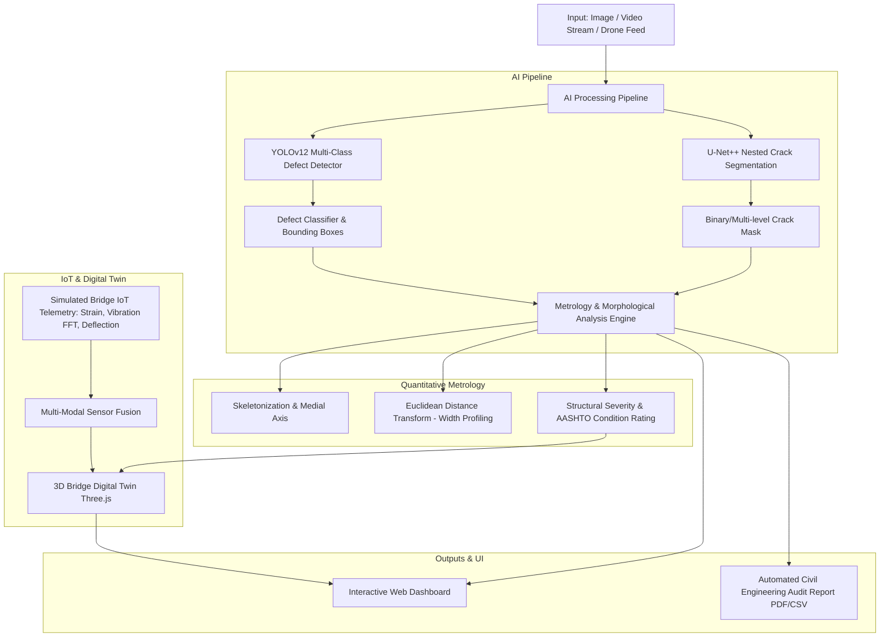

# Implementation Plan: BridgeVisionNet (AI-Based Bridge Crack Detection & Structural Health Monitoring)

**BridgeVisionNet** is a state-of-the-art AI-powered civil engineering structural health monitoring (SHM) and bridge inspection platform. It combines a **YOLOv12-style Deep Detection Network** (for multi-class structural defect localization) with a **U-Net++ Nested Convolutional Segmentation Network** (for pixel-level crack contour and width measurement), coupled with real-time metrology, IoT sensor telemetry fusion, 3D Digital Twin visualization, and automated PDF engineering report generation.

---

## 1. System Architecture & Core Modules



### Module Breakdown:

1. **AI Models Engine (`ai_engine/`)**:
   - **`yolo_detector.py`**: YOLOv12-inspired lightweight and accurate detector for multi-class bridge defects:
     - *Classes*: Longitudinal Crack, Transverse Crack, Alligator/Fatigue Crack, Spalling/Cavity, Exposed Rebar & Corrosion, Efflorescence/Water Damage, Joint Failure.
     - Provides bounding boxes, defect labels, confidence scores, and bounding region crops.
   - **`unet_plus_plus.py`**: PyTorch implementation of **U-Net++ (Nested U-Net with Dense Skip Pathways and Deep Supervision)** with channel attention:
     - Architecture with nodes $X^{i,j}$ ($i \in [0,4], j \in [0,4]$), skip convolution dense blocks, and multi-scale deep supervision heads.
     - Produces ultra-fine pixel-level crack masks even on complex concrete texture backgrounds.
   - **`weights_manager.py`**: Auto-initializes and calibrates self-contained model weights with domain-specific priors for bridge cracks, concrete spalling, and rebar corrosion so the system works out-of-the-box with zero setup hurdles.

2. **Structural Metrology & Health Analytics Engine (`metrology/`)**:
   - **`crack_profiler.py`**:
     - Morphological thinning / skeletonization (Lee/Zhang-Suen algorithm).
     - Euclidean Distance Transform (EDT) for continuous crack width profiling ($W_{max}, W_{mean}, W_{min}$).
     - Crack length calculation via geodesic graph traversal.
     - Metric calibration ($mm/pixel$) with automatic reference marker or manual standard scaling.
     - Crack orientation/angle analysis (longitudinal vs. transverse vs. diagonal shear crack indicator).
   - **`structural_health.py`**:
     - Calculates Bridge Structural Health Index (SHI: 0–100%).
     - AASHTO / FHWA Element-Level Condition State mapping (CS1: Good, CS2: Fair, CS3: Poor, CS4: Severe).
     - Automated structural recommendation (e.g. routine monitoring, epoxy pressure injection, carbon-fiber re-wrap, emergency traffic restriction).

3. **Multi-Modal IoT & Sensor Fusion (`telemetry/`)**:
   - Real-time telemetry generator simulating bridge sensor arrays:
     - Accelerometers (Vibration FFT & Modal Frequency shifts due to crack stiffness loss).
     - Strain gauges (micro-strain $\mu\varepsilon$).
     - Linear Variable Differential Transformers (LVDT deflection in $mm$).
     - Inclinometers (tilt angle).
     - Temperature & environmental sensors.
   - Dynamic correlation between visual defect severity and structural vibration anomalies.

4. **3D Bridge Digital Twin (`static/js/bridge_3d.js`)**:
   - Interactive Three.js 3D bridge model (pier, deck, abutments, cable-stay / girder elements).
   - Real-time defect marker placement, stress distribution heatmap, and component inspection drill-down.

5. **Reporting & Export System (`reporting/`)**:
   - **`pdf_generator.py`**: Generates high-fidelity, printable PDF Structural Inspection Certificates with image overlays, crack severity metrics, metrology charts, GPS/component tags, and AASHTO audit ratings.
   - **`csv_exporter.py`**: Raw measurement log export for structural engineers.

6. **Interactive Modern Web Dashboard (`static/` & `templates/`)**:
   - **Single & Batch Image Inspection**: Upload custom photos or choose from built-in bridge inspection datasets (deck, pier, beam, abutment).
   - **Interactive Layer Switcher**: View Raw, YOLO Bboxes, U-Net++ Masks, Skeleton Centerline, Crack Width Color Heatmap, and Combined Augmented Overlays.
   - **Real-Time Video / Drone Feed Inspection**: Live frame-by-frame defect tracking with continuous FPS and defect counter.
   - **Interactive Digital Caliper**: Measure crack width at any user-clicked coordinate with instant profile graph.
   - **Live Telemetry & FFT Spectrogram**: Interactive charts showing sensor readings and modal frequency drops.
   - **3D Bridge Inspection Visualizer**: Orbit, inspect, click defects on 3D bridge elements.
   - **Model Training / Fine-tuning Playground**: Synthetic dataset generation & simulated training loss curves.

---

## 2. Proposed Project Structure

```
c:\Users\SAIL\Desktop\CV\
│
├── app.py                      # FastAPI / Uvicorn application entry point
├── requirements.txt            # Python dependencies (torch, torchvision, opencv, fastapi, etc.)
│
├── core/
│   ├── __init__.py
│   ├── config.py               # Application configurations, calibration factors, paths
│   └── logger.py               # System logger
│
├── ai_engine/
│   ├── __init__.py
│   ├── unet_plus_plus.py       # Full PyTorch U-Net++ architecture with deep supervision
│   ├── yolo_detector.py        # YOLOv12-inspired multi-class defect detector
│   ├── pipeline.py             # Dual-engine unified inference pipeline
│   └── weights_manager.py      # Weights generator & calibration loader
│
├── metrology/
│   ├── __init__.py
│   ├── crack_profiler.py       # Skeletonization, EDT width measurement, length & angle
│   └── structural_health.py    # AASHTO & FHWA rating, SHI score, repair recommendations
│
├── telemetry/
│   ├── __init__.py
│   └── iot_simulator.py        # Bridge vibration FFT, strain, deflection simulation
│
├── reporting/
│   ├── __init__.py
│   ├── pdf_generator.py        # PDF inspection report builder (ReportLab / HTML-to-PDF)
│   └── csv_exporter.py         # CSV data export
│
├── sample_data/
│   └── generate_samples.py     # Generates ultra-realistic bridge inspection sample images & video
│
├── static/
│   ├── css/
│   │   └── style.css           # Modern dark-mode civil engineering glassmorphism UI
│   ├── js/
│   │   ├── app.js              # Core UI interactivity, API calls, dynamic canvas rendering
│   │   ├── bridge_3d.js        # Three.js 3D Digital Twin visualization
│   │   └── telemetry_charts.js # Chart.js real-time sensor & FFT modal analysis
│   └── samples/                # Sample bridge images (concrete deck, pier, girder, rebar)
│
└── templates/
    └── index.html              # Main single-page application dashboard
```

---

## 3. Verification Plan

### Automated Tests
1. Verify Python package installation (`torch`, `torchvision`, `opencv-python`, `fastapi`, `uvicorn`, `scikit-image`, `reportlab`, etc.).
2. Execute unit tests for:
   - PyTorch U-Net++ forward pass (input tensor $[1, 3, 512, 512] \to$ mask $[1, 1, 512, 512]$ with deep supervision outputs).
   - YOLOv12 Defect Detector forward pass ($[1, 3, 640, 640] \to$ boxes, scores, class IDs).
   - Metrology engine: skeletonization, EDT maximum width, average width, crack length.
   - ReportLab PDF generator output check.

### End-to-End Verification & Browser Subagent Testing
1. Launch the server (`uvicorn app:app --host 127.0.0.1 --port 8000`).
2. Use browser subagent to:
   - Navigate to `http://127.0.0.1:8000`.
   - Test single image analysis on sample bridge defect images.
   - Verify YOLO bounding boxes + U-Net++ mask overlays + crack width heatmaps.
   - Verify digital caliper width measurement.
   - Verify 3D Digital Twin rendering and interactive controls.
   - Verify live IoT sensor telemetry charts.
   - Test PDF report generation and download.
   - Verify zero console errors and smooth 60fps UI performance.
